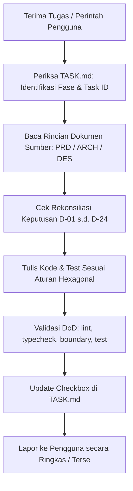

# API Sentinel — AI Agents Master Orchestration & Navigation Guide (`AGENTS.md`)

> **Untuk AI Coding Assistant (Antigravity, Claude, Cursor, Copilot, dll):**
> Dokumen ini adalah **peta orkestrasi utama (master index & orchestration layer)** untuk repository **API Sentinel**.
> Dokumen ini **TIDAK** menduplikasi seluruh detail implementasi. Seluruh spesifikasi definitif, arsitektur, desain visual, dan instruksi tugas tersimpan secara terpisah dalam dokumen sumber. **Buka dan baca file referensi terkait saat mengerjakan tugas tertentu.**

---

## 1. Ikhtisar & Misi Sistem

**API Sentinel** adalah platform pemantauan API *self-hosted* berkinerja tinggi yang dibangun dengan arsitektur **Modular Monolith (Bun Monorepo Workspaces)** menggunakan **Nuxt 4**, **TypeScript**, **PostgreSQL 17+**, **Drizzle ORM**, dan **pg-boss v12**.

Sistem terdiri dari dua runtime utama:
1. `apps/web`: Nitro node-server, Nuxt UI v4 dashboard, REST API (RFC 9457), dan WebSocket real-time engine.
2. `apps/worker`: Daemon proses independen untuk eksekusi probe jaringan SSRF-safe, mesin evaluasi insiden, dan dispatcher notifikasi Telegram.

---

## 2. Hub Dokumen Sumber (Canonical Source of Truth)

Setiap agen AI **WAJIB** merujuk pada dokumen sumber berikut berdasarkan konteks tugas:

| Dokumen | Path | Peran & Cakupan | Kapan Harus Dibaca |
|---|---|---|---|
| **PRD** | [PRD.md](./PRD.md) | Kebutuhan produk, 30 User Story, aturan bisnis (uptime, downtime, insiden), ambang batas, sanitasi data, dan kriteria MVP. | Saat merancang use case, menentukan logika domain, kriteria validasi, dan alur bisnis. |
| **ARCHITECTURE** | [ARCHITECTURE.md](./ARCHITECTURE.md) | Arsitektur Hexagonal (Ports & Adapters), DDD boundaries, skema DB PostgreSQL, relasi Drizzle, keamanan SSRF, enkripsi Libsodium, pg-boss, real-time WebSocket, OTel. | Saat menulis kode domain, use case, port/adapter infra, migrasi database, probe jaringan, atau API route. |
| **DESIGN** | [DESIGN.md](./DESIGN.md) | Sistem desain *True Dark Terminal Monospace* (`#09090b`), token warna Nuxt UI v4 & Tailwind v4, tipografi Geist/JetBrains Mono, blueprint 7 layar observabilitas, state transisi, dan aksesibilitas (WCAG 2.1 AA). | Saat membangun komponen UI, halaman dashboard, drawer inspeksi, layout, atau grafik chart. |
| **TASK** | [TASK.md](./TASK.md) | Roadmap implementasi Fase 0 s.d. 18, 24 keputusan teknis rekonsiliasi (D-01 s.d. D-24), Definition of Done, checklist langkah per tugas, dan mitigasi risiko. | **Setiap saat sebelum dan sesudah menulis kode.** Digunakan untuk mengambil tugas berikutnya dan menandai progres. |

### Hierarki Resolusi Konflik (*Precedence Rule*):
1. **Keputusan Rekonsiliasi `TASK.md § Fase 0 (D-01 s.d. D-24)`** memiliki prioritas tertinggi di atas draf awal dokumen lainnya.
2. **`ARCHITECTURE.md`** adalah otoritas tertinggi untuk struktur teknis, kontrak data, keamanan, dan backend.
3. **`DESIGN.md`** adalah otoritas tertinggi untuk visual, token warna, tata letak, dan komponen frontend.
4. **`PRD.md`** adalah otoritas tertinggi untuk definisi kebutuhan bisnis dan kriteria keberhasilan produk.

---

## 3. Aturan Inti Proyek & Guardrails (Mandatory Project Rules)

### 3.1. Kemurnian Lapisan Domain (DDD & Hexagonal Purity)
- `packages/domain` **HARAM** memiliki dependensi ke I/O, network, framework, database, atau package eksternal. Murni logika bisnis, entitas, agregat, value object, dan domain events.
- `packages/application` hanya bergantung pada `domain` dan `contracts`. Semua interaksi eksternal dilakukan melalui **Outbound Ports**.
- `packages/infra` mengimplementasikan Outbound Ports dari `application`.
- `apps/web` dan `apps/worker` adalah Driving/Inbound Adapters (Composition Root).

### 3.2. Integritas Transaksional (No Dual-Write)
- Perubahan status monitor, pencatatan `check_results`, insiden, dan antrean notifikasi **WAJIB** berada dalam **satu transaksi database PostgreSQL tunggal** (Unit of Work).
- Pengiriman job pg-boss menggunakan transaksi yang sama: `boss.send(..., { db: tx })` melalui adapter `fromDrizzle`.

### 3.3. Protokol Keamanan & Zero-Leak (Strict Security)
- **Zero Hardcoded Secrets**: Dilarang keras menuliskan password, API key, token, atau secret key di dalam kode sumber.
- **ENV-First**: Seluruh konfigurasi sensitif wajib dibaca via environment variables yang divalidasi skema Zod (ARCH §10). Sediakan contoh variabel pada `.env.example`.
- **Git Guard**: Pastikan `.env` dan file kredensial lokal selalu terdaftar di `.gitignore`.
- **Enkripsi Kredensial**: Header sensitif, Bearer token, dan Telegram Bot Token dienkripsi menggunakan Libsodium XChaCha20-Poly1305 AEAD dengan Associated Authenticated Data (AAD) unik sebelum disimpan ke DB.
- **SSRF Prevention**: Probe worker menggunakan custom Node.js HTTP/HTTPS Agent dengan socket DNS IP-pinning (`all: true`). Melarang akses ke range RFC 1918, link-local, loopback, dan cloud metadata (169.254.169.254).
- **Log Sanitization**: Token Telegram (`/bot\d+:[A-Za-z0-9_-]+/`), Authorization header, dan request/response body rahasia diredaksi sebelum masuk log atau respons API.
- **Safe JSONPath**: Evaluasi assertion JSONPath menggunakan AST parser mandiri tanpa fungsi `eval()` atau `new Function()`.

### 3.4. Disiplin Dependensi & Dokumentasi Eksternal
- **Latest Stable Verified Docs**: Gunakan dokumentasi resmi stabil terbaru untuk pustaka yang digunakan (Nuxt 4, Nitro, Nuxt UI v4, Drizzle ORM, pg-boss v12, Node.js 24 LTS, Bun 1.3+).
- **No Assumption**: Jangan berasumsi atau menebak behavior API/library. Selalu verifikasi spesifikasi fungsi terhadap dokumentasi resmi atau kode types.
- **Dokumentasi Terkontrol**: Dilarang membuat file Markdown baru (seperti README atau ringkasan) tanpa persetujuan eksplisit dari pengguna.

### 3.5. Disiplin Rekayasa & Refactoring Aman (Safe Refactor)
- **Direct Output**: Berikan kode siap pakai, modular, dan bersih (bebas komentar redundan, nesting abnormal, dan `any` type casts). Penjelasan hanya untuk logika yang sangat kompleks.
- **Safe Refactor Only**: Jangan mengubah perilaku eksisting tanpa instruksi langsung. Pertahankan kompatibilitas penuh (*backward compatibility*).
- **Struktur & Penamaan Konsisten**: Letakkan file baru persis sesuai arsitektur monorepo (`packages/*` vs `apps/*`) dan ikuti konvensi penamaan (`kebab-case` untuk file, `PascalCase` untuk kelas/komponen).

### 3.6. Standar Estetika Monospace & Nuxt UI v4
- Menggunakan tema **True Dark Monospace** (latar `#09090b`, garis hairline 1px `#27272a`, font monospace).
- Dilarang menggunakan warna Tailwind hardcoded acak (misal `text-emerald-500` atau `bg-zinc-800` langsung); gunakan token semantik Nuxt UI v4 (`primary`, `neutral`, `status-operational`, `status-down`, dll) sesuai [DESIGN.md §2](./DESIGN.md#2).

---

## 4. Peta Navigasi Cepat (AI Agent Routing Map)

Gunakan tabel ini untuk melompat langsung ke dokumen dan seksi yang relevan:

| Topik / Kebutuhan Implementasi | File & Seksi Referensi |
|---|---|
| **Daftar Tugas & Status Pengerjaan** | [TASK.md § Cara Memakai Dokumen Ini](./TASK.md#cara-memakai-dokumen-ini) |
| **Keputusan Teknis & Patch D-01 s.d. D-24** | [TASK.md § Fase 0](./TASK.md#fase-0--rekonsiliasi-dokumen--keputusan-teknis) |
| **Struktur Monorepo & Dependencies** | [ARCHITECTURE.md §1.2 & §2](./ARCHITECTURE.md#12-spesifikasi-matriks-stack-teknologi-definitif-verified-registry) |
| **Domain Monitor, Incident, & Assertion AST** | [ARCHITECTURE.md §3](./ARCHITECTURE.md#3-lapisan-domain-packagesdomain) & [PRD.md §4.7](./PRD.md#47-validasi-respons-dan-assertion) |
| **Use Cases (Commands & Queries)** | [ARCHITECTURE.md §4](./ARCHITECTURE.md#4-lapisan-aplikasi-packagesapplication) |
| **Mitigasi SSRF & Agent Socket Pinning** | [ARCHITECTURE.md §5.1](./ARCHITECTURE.md#51-mitigasi-server-side-request-forgery-ssrf-pada-network-probe) |
| **Kriptografi AEAD Libsodium & Secret Vault** | [ARCHITECTURE.md §5.2](./ARCHITECTURE.md#52-zero-leak-secret-architecture--kriptografi-aead) |
| **Skema Database PostgreSQL & Drizzle ORM** | [ARCHITECTURE.md §6.1](./ARCHITECTURE.md#61-skema-database-relasional-postgresql-17-drizzle-orm) |
| **Antrean Pekerjaan pg-boss v12 & Workers** | [ARCHITECTURE.md §6.3 & §7](./ARCHITECTURE.md#63-arsitektur-antrean-pekerjaan-pg-boss-v12) |
| **State Machine Insiden & Pemulihan** | [PRD.md §4.12](./PRD.md#412-ambang-batas-dan-status-insiden) & [ARCHITECTURE.md §7.2](./ARCHITECTURE.md#72-incident-evaluation-engine--state-machine) |
| **Integrasi Notifikasi Telegram & Retries** | [PRD.md §4.14](./PRD.md#414-notifikasi-telegram) & [ARCHITECTURE.md §6.4](./ARCHITECTURE.md#64-adapter-notifikasi-telegram-bot-api) |
| **Real-time Engine: LISTEN/NOTIFY & Cross-WS** | [ARCHITECTURE.md §8](./ARCHITECTURE.md#8-real-time-inter-process-communication--websocket-engine) |
| **REST API Specs & RFC 9457 Errors** | [ARCHITECTURE.md §9](./ARCHITECTURE.md#9-spesifikasi-api-rest-contracts--serialisasi) |
| **Token Warna, Tipografi & Design System** | [DESIGN.md §colors, typography, & §1-§4](./DESIGN.md#colors) |
| **Blueprint UI: Dashboard, Monitor, & Drawers** | [DESIGN.md §5](./DESIGN.md#5-observability-screens--interaction-blueprints) |
| **Uptime Calculation & History Rollups** | [PRD.md §4.11](./PRD.md#411-perhitungan-uptime-dan-agregasi-metrik) & [ARCHITECTURE.md §6.1](./ARCHITECTURE.md#61-skema-database-relasional-postgresql-17-drizzle-orm) |
| **Docker, CI/CD, & Observabilitas OTel** | [ARCHITECTURE.md §11 & §12](./ARCHITECTURE.md#11-containerization-docker-compose--cicd) |

---

## 5. Alur Kerja Eksekusi AI (Agent Execution Protocol)

Setiap agen yang menerima perintah harus mengikuti siklus kerja standar berikut:

### Langkah Standar:
1. **Identifikasi Task:** Baca [TASK.md](./TASK.md) untuk memastikan task ID (misal `P0.1`, `P2.1`, `P8.3`). Pastikan prasyarat task sudah terpenuhi.
2. **Navigasi Konteks:** Buka file sumber spesifikasi yang ditunjuk di kolom referensi task ([PRD.md](./PRD.md), [ARCHITECTURE.md](./ARCHITECTURE.md), atau [DESIGN.md](./DESIGN.md)).
3. **Implementasi Kode Bersih:** Tulis kode modular yang siap pakai dengan penanganan error terstruktur (RFC 9457) tanpa bypass `any`.
4. **Verifikasi Definition of Done (DoD Gate):**
   - `bun run lint` (Biome) bersih tanpa error/warning.
   - `bun run typecheck` TypeScript bersih tanpa error.
   - `bun run check:boundaries` arsitektur monorepo lulus (domain tidak mengimpor infra/framework).
   - Unit/integration test tersedia dan berstatus pass (hijau).
   - Zero leak kredensial terverifikasi (tidak ada data rahasia di log/response).
5. **Pencatatan Progres:** Beri centang `[x]` pada task yang selesai di [TASK.md](./TASK.md).

---

## 6. Protokol Komunikasi & Efisiensi Token

- **Ringkas & Presisi:** Jangan memberikan penjelasan panjang bertele-tele jika tidak diminta. Fokus pada tindakan kode, status task, dan hasil eksekusi.
- **Format Tautan File:** Gunakan format tautan GitHub markdown standar dengan skema `file://` atau relatif markdown (contoh: `[ARCHITECTURE.md](./ARCHITECTURE.md)`).
- **Akses Mandiri:** Jangan menebak isi dokumen. Selalu baca dokumen sumber secara mandiri menggunakan perkakas file viewer jika detail belum ada di memori konteks.
